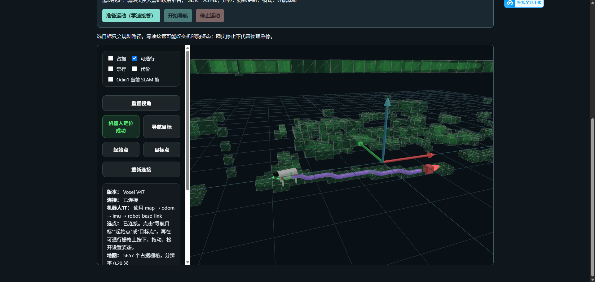

# V5 冻结版现场验收记录

此页依据 2026-11-13 原 AGX 的现场记录和冻结快照整理。此后新增验收时，请登记实际运行的版本、地图、场地、结果和证据位置。

| 项目 | 已有证据或待办 |
| --- | --- |
| Odin1 建图、保存 BIN | 有原 AGX 现场记录。 |
| 同源 BIN 转换点云、生成导航包并加载 | 已用有效地图验证。 |
| Odin1 重定位、三维图层和同层选点规划 | 冻结清单记录位姿更新、网页三维显示及一条 9 点规划路径。 |
| 冻结 V5 的实机零速接管、短路线到点、停车反馈和掉线锁定 | 待现场逐项验收。 |
| 全新 AGX 从零安装 | 待在隔离部署中验收。 |

同源示例地图在原 AGX 的交接归档中已有记录。接手人应按[正式部署说明](https://github.com/Pandc-12478/agx-odin1-quadruped-navigation/blob/main/v5-web/DEPLOY.md)取得数据，登记源 BIN 与对应规划包。当前资料未确认该示例是否正是晚间 9 点规划所用的地图。

## 2026-11-16 网页选点规划截图

V5 Web 三维页（Voxel V47）显示「机器人定位成功」、绿色可通行栅格，以及连接机器人起点与红色目标的紫色规划路径。截图用于记录本次无运动选点规划。此次使用的地图名待补录。

公开快照源码可对照[文档更新前的提交](https://github.com/Pandc-12478/odin3d-agx-cyvet-v5-handoff/commit/175bdc340ffc47e9b9ad3e67891c38c433b0cdd0)。2026-11-13 那轮规划的原始路线日志待补。
